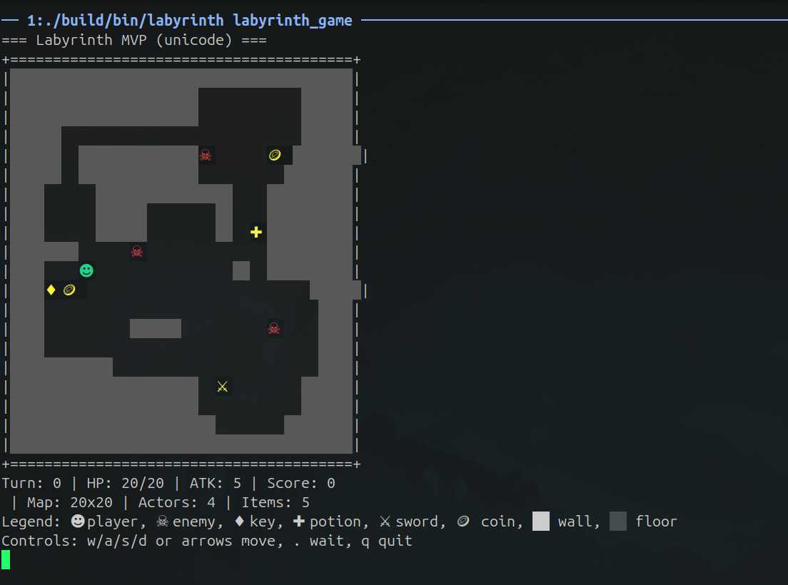
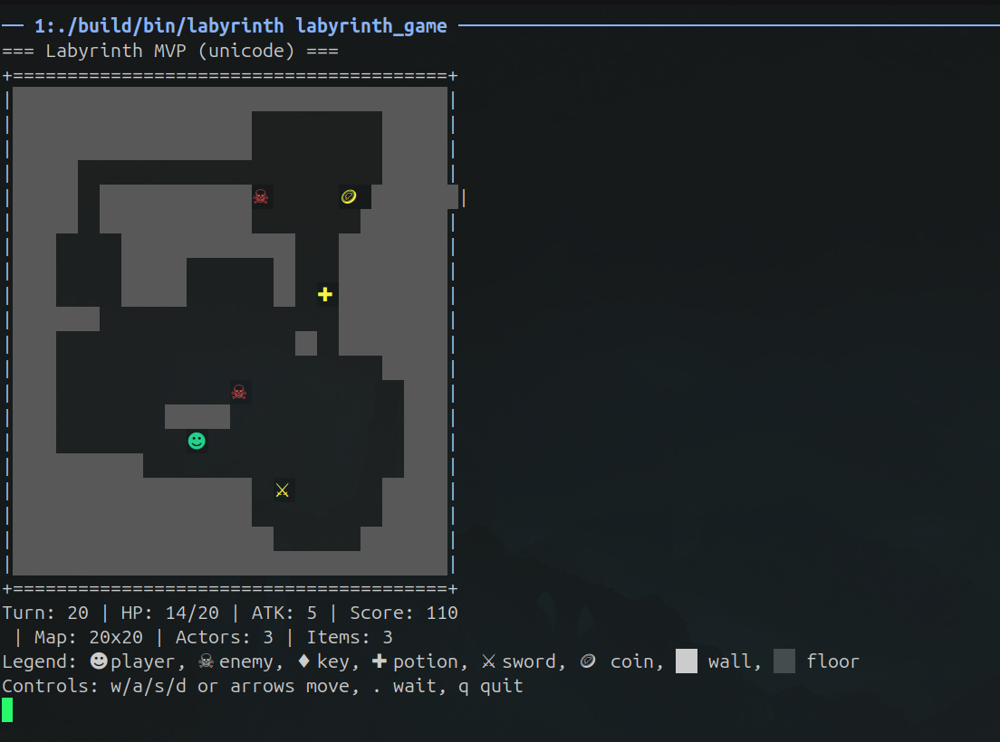
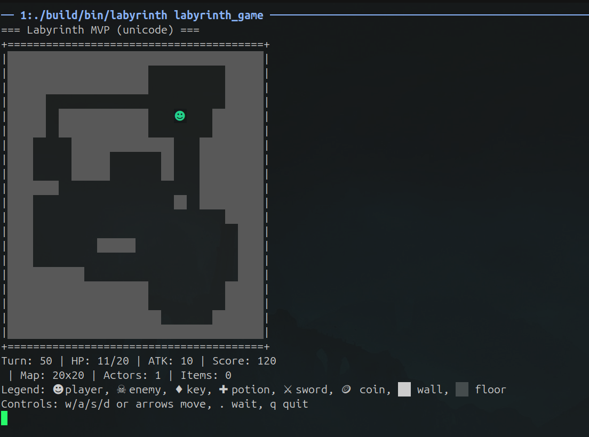

# Labyrinth

Labyrinth is an early C++20 console roguelike. The current MVP generates a seeded dungeon, supports player movement, enemy pursuit and combat, and collectible keys, potions, swords, and coins. Save/load and a complete victory condition are not implemented yet.

## Prerequisites

- CMake 3.20 or newer
- A C++20 compiler (GCC, Clang, or MSVC)

## Build and run

```sh
cmake --preset release
cmake --build --preset release
./build/release/bin/labyrinth
```

Use `--seed=<number>` for a reproducible dungeon and `--symbols=unicode` for Unicode glyphs. ASCII is the default.

## Controls

- `W`, `A`, `S`, `D` or arrow keys: move
- `.`: wait one turn
- `Q`: quit

When input is redirected, commands may also be written as `up`, `down`, `left`, `right`, `quit`, or `exit`, one per line.

## Unicode gameplay

These screenshots show one gameplay session with Unicode symbols. The map and
route can vary between runs; the screenshots do not specify a reproducible seed
or command sequence.

### Starting the game

Turn 0: HP 20/20, attack 5, score 0, four actors and five items.



### Exploring and collecting items

Turn 20: HP 14/20, attack 5, score 110, three actors and three items remaining.



### Clearing enemies and collecting all items

Turn 50: HP 11/20, attack 10, score 120, only the player remains and no items
remain. This state does not imply that a victory condition has been implemented.



## Tests

```sh
cmake --preset debug
cmake --build --preset debug
ctest --preset debug
```

The debug preset enables AddressSanitizer and UndefinedBehaviorSanitizer on GCC and Clang. A non-sanitized `release` test preset is also available.

## License

Released under the [MIT License](LICENSE).
